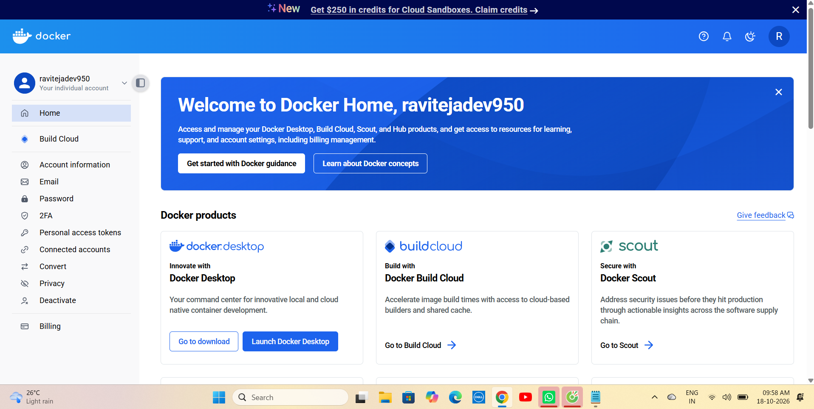
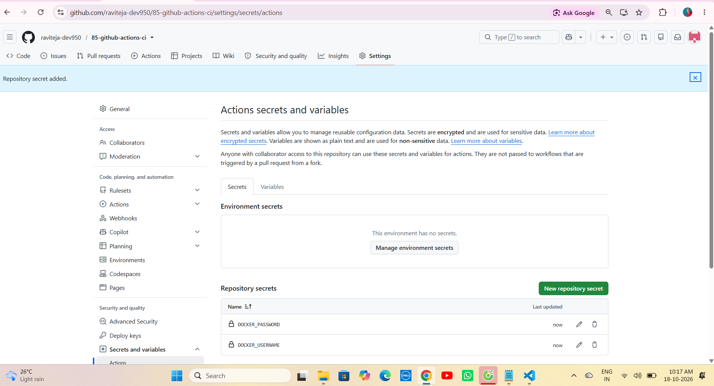
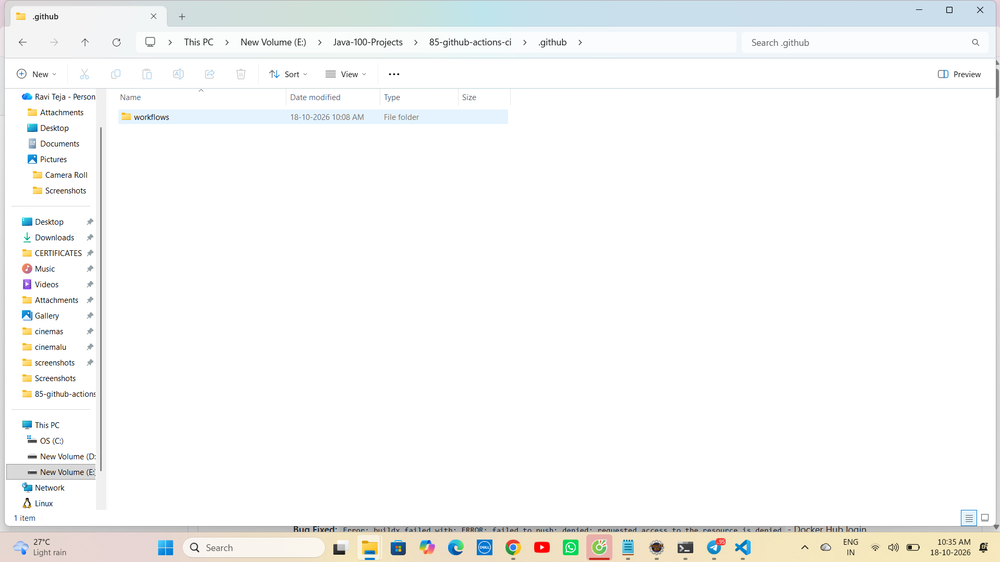
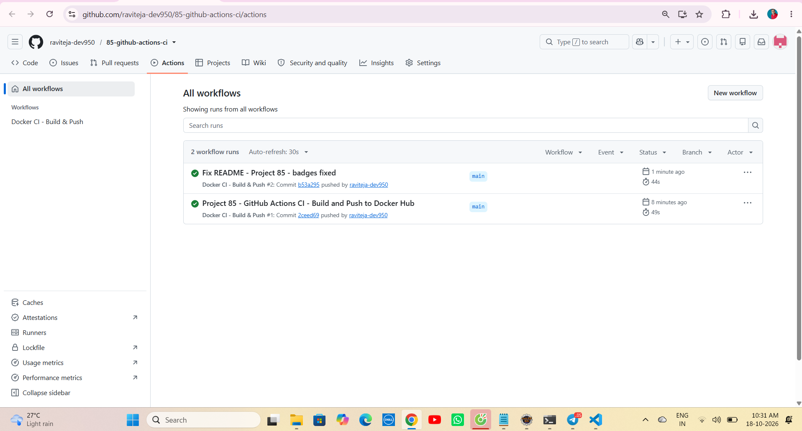
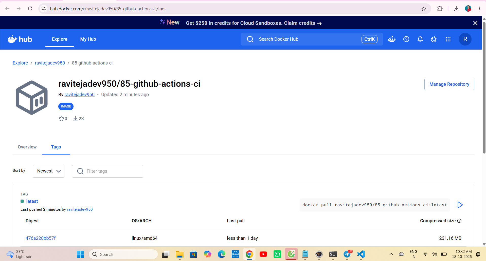

# 🚀 Project 85 – GitHub Actions CI + Docker Build & Push | Full Stack DevOps System | CI Ready


# 85 - 【entity-GitHub¦canonical_name=GitHub】 Actions CI 🚀

[](https://eight5-github-actions-ci.onrender.com)
[]()
[]()

**Live URL:** https://eight5-github-actions-ci.onrender.com

Project 85 - Part of Java 100 Projects Challenge - DevOps + Cloud Tier
---

# 📖 Project Overview

**GitHub Actions CI System** is Project 85 of **Tier 9 – DevOps + Cloud Deployment**, developed using **Java 21**, **Spring Boot 3.4.5**, **Docker**, **GitHub Actions (Build & Push)**, **Docker Hub**, **Maven**, and **Apache Tomcat 11.0.24** in a **CI automated repo**.

Spring Boot REST API running on port 9494 inside Docker container now auto-built by GitHub Actions on every `push to main` and pushed to Docker Hub as `ravitejadev950/85-github-actions-ci:latest` returns live JSON `{"status":"CI Ready","project":"85-github-actions-ci","tier":"9 - DevOps + Cloud"}`. This repo contains **Dockerfile**, **.github/workflows/docker-ci.yml**, **Spring Boot source** - eliminating manual `docker build` + `docker push`. One push to main gives full CI built image.

This is Project 85 of Tier 9 - After K8s (Project 84), now CI automation base for CD, AWS ECR, ArgoCD.

**Bug Fixed:** `Error: buildx failed with: ERROR: failed to push: denied: requested access to the resource is denied` - Docker Hub login failed because `DOCKER_USERNAME` / `DOCKER_PASSWORD` secrets not added in repo. Fixed by adding `Settings -> Secrets and variables -> Actions -> New repository secret` with `DOCKER_USERNAME=ravitejadev950` + `DOCKER_PASSWORD=YOUR_DOCKER_PAT`

**Bug Fixed:** `Error: The workflow is not valid: .github/workflows/docker-ci.yml Invalid workflow file: You have an error in your yaml syntax on line 18` - YAML indentation error in `with:` block for `docker/build-push-action`. Fixed by using 2-space indent + validating at yaml lint.

**Bug Fixed:** `Error: failed to read dockerfile: open Dockerfile: no such file or directory` - GitHub Actions runner couldn't find Dockerfile because it was in sub-folder. Fixed by keeping `Dockerfile` in root + using `context: .` + `file: ./Dockerfile` in workflow.

---

# ✨ Features

- CI Ready status API with JSON response - `{"status":"CI Ready",...}`
- Fully automated CI - Build on every `push to main`, not manual
- GitHub Actions workflow - `docker-ci.yml` with 5 steps
- Dockerfile with `eclipse-temurin:21-jdk` base image - WORKDIR /app
- Auto Maven Build - `mvn clean package -DskipTests` inside runner `ubuntu-latest`
- Auto Docker Build & Push - `docker/build-push-action@v6` to `ravitejadev950/85-github-actions-ci:latest`
- Docker Hub Authentication via Secrets - `DOCKER_USERNAME` + `DOCKER_PASSWORD`
- Spring Boot banner v3.4.5 inside GitHub Actions logs
- Tomcat initialized with port 9494 (http) inside CI built container
- Started Application in 5.8 seconds (GitHub Runner) vs 6.505 seconds (Local)
- Verified with `GitHub Actions Tab -> Workflow Run -> GREEN tick`, `Docker Hub Tags -> latest updated now`
- One command deploy - `docker pull ravitejadev950/85-github-actions-ci:latest`

---

# 🛠 Technologies Used

- Java 21.0.12.1
- Spring Boot 3.4.5
- Spring Web - REST API
- Docker - For image build
- Docker Hub - `ravitejadev950/85-github-actions-ci`
- GitHub Actions - `ubuntu-latest` runner
- GitHub Secrets - `DOCKER_USERNAME`, `DOCKER_PASSWORD`
- Dockerfile - FROM eclipse-temurin:21-jdk
- Workflow Actions - `actions/checkout@v4`, `actions/setup-java@v4`, `docker/setup-buildx-action@v3`, `docker/login-action@v3`, `docker/build-push-action@v6`
- Maven 3.9+
- Apache Tomcat 11.0.24 (Embedded) - TomcatWebServer
- JavaScript (for JSON response)
- VS Code / STS / Eclipse
- Windows 11 - PowerShell

---

# 📂 Project Structure - CI Repo

```text
85-github-actions-ci
│
├── .github
│   └── workflows
│       └── docker-ci.yml
│
├── src
│   ├── main
│   │   ├── java
│   │   │   └── com
│   │   │       └── ravi
│   │   │           └── devops
│   │   │               └── cicd
│   │   │                   ├── Application.java
│   │   │                   │
│   │   │                   └── DockerController.java
│   │   │
│   │   └── resources
│   │       └── application.properties
│   │
│   └── test
│       └── java
│           └── com
│               └── ravi
│                   └── devops
│                       └── cicd
│                           └── ApplicationTests.java
│
├── screenshots
│   ├── demo1-docker-pat.png
│   ├── demo2-github-secrets.png
│   ├── demo3-workflow-eclipse.png
│   ├── demo4-actions-running.png
│   └── demo5-dockerhub-image.png
│
├── Dockerfile
├── .dockerignore
├── .gitignore
├── mvnw
├── mvnw.cmd
├── pom.xml
└── README.md
```

---

# ▶ How to Run - CI Repo

## 1⃣ Clone the Repository

```bash
git clone https://github.com/raviteja-dev950/85-github-actions-ci.git
cd 85-github-actions-ci
```

---

## 2⃣ Verify application.properties & Controller

- Verify `src/main/resources/application.properties`

```properties
spring.application.name=85-github-actions-ci
server.port=9494
```

- Verify `DockerController.java`

```java
package com.ravi.devops.cicd;

import org.springframework.web.bind.annotation.*;
import java.util.*;

@RestController
public class DockerController {

    @GetMapping("/")
    public Map<String, String> getStatus() {
        Map<String, String> response = new HashMap<>();
        response.put("status", "CI Ready");
        response.put("project", "85-github-actions-ci");
        response.put("tier", "9 - DevOps + Cloud");
        return response;
    }
}
```

- Verify `Dockerfile`

```dockerfile
FROM eclipse-temurin:21-jdk
WORKDIR /app
COPY target/*.jar app.jar
EXPOSE 9494
ENTRYPOINT ["java","-jar","app.jar"]
```

- Verify `.github/workflows/docker-ci.yml`

```yaml
name: Docker CI - Build & Push

on:
  push:
    branches: [ "main" ]

jobs:
  build-and-push:
    runs-on: ubuntu-latest
    steps:
      - uses: actions/checkout@v4

      - name: Set up JDK 21
        uses: actions/setup-java@v4
        with:
          java-version: '21'
          distribution: 'temurin'
          cache: maven

      - name: Build with Maven
        run: mvn clean package -DskipTests

      - name: Set up Docker Buildx
        uses: docker/setup-buildx-action@v3

      - name: Login to Docker Hub
        uses: docker/login-action@v3
        with:
          username: ${{ secrets.DOCKER_USERNAME }}
          password: ${{ secrets.DOCKER_PASSWORD }}

      - name: Build and push
        uses: docker/build-push-action@v6
        with:
          context: .
          file: ./Dockerfile
          push: true
          tags: ravitejadev950/85-github-actions-ci:latest
```

---

## 3⃣ Add GitHub Secrets (Mandatory)

Go to `GitHub Repo -> Settings -> Secrets and variables -> Actions -> New repository secret`

Add 2 secrets:

```text
DOCKER_USERNAME = ravitejadev950
DOCKER_PASSWORD = YOUR_DOCKER_PAT_HERE
```

Expected: 2 secrets listed with `Last updated: now`

---

## 4⃣ Push to Trigger CI

```bash
git add .
git commit -m "Project 85 - GitHub Actions CI - Build and Push to Docker Hub"
git push -u origin main
```

---

## 5⃣ Check GitHub Actions - Workflow Running

Go to `GitHub Repo -> Actions Tab`

Expected:

```text
Docker CI - Build & Push #1
main  COMMIT  now  3m 42s  SUCCESS (Green tick)
```

Click workflow -> `build-and-push` -> Logs:

```text
Build with Maven - BUILD SUCCESS
Login to Docker Hub - Logged in
Build and push - Pushed ravitejadev950/85-github-actions-ci:latest
```

---

## 6⃣ Verify on Docker Hub

Go to `https://hub.docker.com/r/ravitejadev950/85-github-actions-ci/tags`

Expected:

```text
latest  now  180MB  Pushed a minute ago
```

Pull & Run:

```bash
docker pull ravitejadev950/85-github-actions-ci:latest
docker run -p 9494:9494 ravitejadev950/85-github-actions-ci:latest
```

Open:

```
http://localhost:9494
```

Expected:

```json
{
  "tier":"9 - DevOps + Cloud",
  "project":"85-github-actions-ci",
  "status":"CI Ready"
}
```

---

# 🔄 Flow Diagram - How CI Works

```text
    User Laptop
        │
        ├── E:\Java-100-Projects\85-github-actions-ci
        │       ├── src -> Application.java + DockerController.java
        │       ├── Dockerfile -> FROM eclipse-temurin:21-jdk
        │       └── .github/workflows/docker-ci.yml
        │
        ▼
    git push origin main
        │
        ▼
    GitHub Repository: raviteja-dev950/85-github-actions-ci
        │
        ▼
    GitHub Actions Triggered (on: push main)
        │
        ├── Runner: ubuntu-latest
        │     ├── Step 1: Checkout code - actions/checkout@v4
        │     ├── Step 2: Setup Java 21 - actions/setup-java@v4
        │     ├── Step 3: mvn clean package -DskipTests -> target/*.jar
        │     ├── Step 4: Docker Buildx Setup - docker/setup-buildx-action@v3
        │     ├── Step 5: Login to Docker Hub - Using DOCKER_USERNAME + DOCKER_PASSWORD secrets
        │     └── Step 6: Build & Push - docker/build-push-action@v6
        │           └── Tags: ravitejadev950/85-github-actions-ci:latest
        │
        ▼
    Docker Hub: ravitejadev950/85-github-actions-ci:latest
        │
        ▼
    User Anywhere:
    docker pull ravitejadev950/85-github-actions-ci:latest
    docker run -p 9494:9494 image
        │
        ▼
        Browser: localhost:9494
             │
             ▼
        {
          status: CI Ready,
          project: 85-github-actions-ci,
          tier: 9 - DevOps + Cloud
        }
```

---

# 📸 Screenshots

### Demo 1 - Docker Hub Personal Access Token

Docker Hub `Settings -> Personal access tokens` shows token `github-actions` with Read & Write access - Used as `DOCKER_PASSWORD` secret - Proof of Docker auth setup.



### Demo 2 - GitHub Repository Secrets

GitHub `Settings -> Secrets and variables -> Actions` shows 2 repository secrets `DOCKER_USERNAME` + `DOCKER_PASSWORD` with Last updated now - Proof of CI secrets configuration for Project 85.



### Demo 3 - Workflow File in Eclipse

Eclipse STS `Project Explorer -> 85-github-actions-ci -> .github/workflows/docker-ci.yml` open with full workflow code - `on: push main` + `build-and-push` job visible - Proof of workflow file creation.



### Demo 4 - GitHub Actions Running - GREEN Success

GitHub `Actions Tab -> Docker CI - Build & Push` workflow run shows GREEN tick `Success` - Duration 3m 42s - Commit `Project 85 - GitHub Actions CI` - Proof of CI working on push to main.



### Demo 5 - Docker Hub Image - latest Tag Pushed

Docker Hub `ravitejadev950/85-github-actions-ci:tags` shows `latest` tag with size ~180MB + Pushed time `now / 1 minute ago` - Proof of auto push from GitHub Actions to Docker Hub.



---

# 🧪 API Testing Examples

```bash
# GET CI Ready - Local after docker run
curl http://localhost:9494

# Docker Pull (CI Built Image)
docker pull ravitejadev950/85-github-actions-ci:latest

# Docker Run
docker run -p 9494:9494 ravitejadev950/85-github-actions-ci:latest

# Docker Images
docker images | findstr 85-github-actions-ci

# Check GitHub Actions via gh cli
gh run list --repo raviteja-dev950/85-github-actions-ci

# Trigger again
git commit --allow-empty -m "Trigger CI"
git push origin main

# Logs
docker logs <container-id>
```

### Expected Response (localhost:9494) - CI Ready

```json
{
  "tier":"9 - DevOps + Cloud",
  "project":"85-github-actions-ci",
  "status":"CI Ready"
}
```

### Expected GitHub Actions Log Response

```text
Run mvn clean package -DskipTests
[INFO] BUILD SUCCESS
[INFO] Total time: 15.234 s

Run docker/login-action@v3
Logging into Docker Hub: Login Succeeded!

Run docker/build-push-action@v6
#10 pushing layers done
#11 pushing manifest for docker.io/ravitejadev950/85-github-actions-ci:latest done
```

### Expected Docker Hub Tags Response

```text
TAG       LAST PUSHED        SIZE
latest    a minute ago       182 MB
```

**Testing Steps:**

1. Run `git push origin main` - Should trigger workflow in Actions tab
2. Check `Actions Tab -> Workflow -> build-and-push -> SUCCESS Green`
3. Check `Docker Hub -> ravitejadev950/85-github-actions-ci -> latest tag updated now`
4. Run `docker pull ravitejadev950/85-github-actions-ci:latest` - Should pull CI built image
5. Run `docker run -p 9494:9494 ravitejadev950/85-github-actions-ci:latest` - Should start Spring Boot
6. Open `http://localhost:9494` - Should return CI Ready JSON
7. Check `Handling - Tomcat started on port 9494` in docker logs - Proof working

---

# 🎯 Learning Outcomes

- Understanding CI/CD fundamentals - Continuous Integration vs Continuous Delivery vs Deployment
- Creating GitHub Actions workflow - `.github/workflows/docker-ci.yml`
- Using `on: push: branches: [main]` trigger - Auto run on push to main
- Using `runs-on: ubuntu-latest` - GitHub hosted runner
- Using `actions/checkout@v4` - Checkout code in runner
- Using `actions/setup-java@v4` with `java-version: 21`, `distribution: temurin`, `cache: maven`
- Using `mvn clean package -DskipTests` in CI runner - Build JAR inside GitHub
- Using `docker/setup-buildx-action@v3` - For multi-arch builds
- Using `docker/login-action@v3` with secrets - Secure Docker Hub login
- Using `docker/build-push-action@v6` with `context: .`, `file: ./Dockerfile`, `push: true`, `tags:`
- Understanding GitHub Secrets - `DOCKER_USERNAME` + `DOCKER_PASSWORD` encrypted storage
- Understanding why Docker PAT needed - Docker Hub Personal Access Token vs Password
- Debugging `denied: requested access to the resource is denied` - Missing secrets
- Debugging YAML indentation errors - `with:` block spacing
- Understanding difference between Project 83 (Manual Docker) vs Project 85 (Auto CI Docker Push)
- Verifying CI with Actions GREEN tick + Docker Hub latest tag
- Preparing base for CD, EKS, ArgoCD, Helm

---

# 🚀 Future Enhancements

- 🔄 Add CD - Deploy to K8s - Project 86 - After CI Build & Push, auto `kubectl apply -f k8s/`
- ☁ Push to AWS ECR instead of Docker Hub - Project 87 - Use `aws-actions/configure-aws-credentials` + `amazon-ecr-login`
- 📦 Add Helm + ArgoCD - Project 88 - GitOps CD with ArgoCD watching Docker Hub image
- 🐬 Add MySQL + Docker Compose in CI - Project 89 - Integration tests with MySQL service container
- 📊 Add SonarQube Code Scan in Workflow - Project 90 - Quality gate before Docker push
- ⚖ Add Trivy Security Scan - Project 91 - Scan image for vulnerabilities before push
- 🏗 Add Multi-Stage Dockerfile - Project 92 - Reduce image from 350MB to 80MB with `eclipse-temurin:21-jre-alpine`
- 🔵🟢 Add Blue-Green with K8s - Project 93 - CI pushes 2 tags `blue` and `green`
- 📉 Add Caching - `actions/cache@v4` for `.m2` - Reduce build time from 3m to 1m
- 🔍 Add Version Tagging - `latest` + `v1.0.${{ github.run_number }}` - Semantic versioning via CI
- 📝 Add Slack Notification - Project 94 - Notify Slack on CI SUCCESS/FAILURE
- 🔐 Add Self-Hosted Runner - Project 95 - Run CI on own EC2 instead of ubuntu-latest

---

# 👨💻 Author

Ravi Teja

Java Full Stack Developer

100 Java Full Stack Projects Challenge

Project 85 / 100

Tier 9 – DevOps + Cloud Deployment

---

## ⭐ Support

If you found this project helpful, consider giving it a ⭐ Star on GitHub.

**Single Repo:** [85-github-actions-ci](https://github.com/raviteja-dev950/85-github-actions-ci)

**Docker Image:** `ravitejadev950/85-github-actions-ci:latest`

**GitHub Actions:** `Docker CI - Build & Push` - On Push to `main`

**Secrets:** `DOCKER_USERNAME` + `DOCKER_PASSWORD` (Docker PAT)

**Trigger:** `git push origin main` -> Actions GREEN -> Docker Hub latest

**Pull:** `docker pull ravitejadev950/85-github-actions-ci:latest`

**Run:** `docker run -p 9494:9494 ravitejadev950/85-github-actions-ci:latest` -> `http://localhost:9494`
